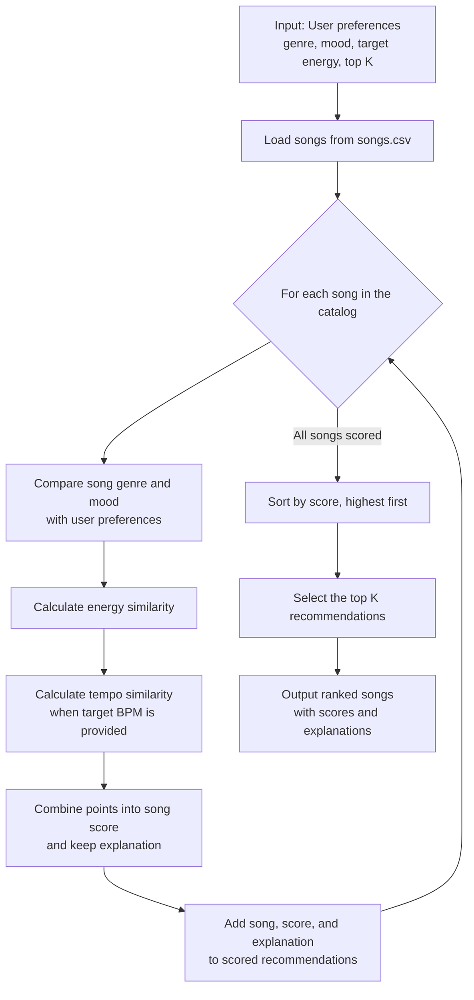

# 🎵 Music Recommender Simulation

## Project Summary

In this project you will build and explain a small music recommender system.

Your goal is to:

- Represent songs and a user "taste profile" as data
- Design a scoring rule that turns that data into recommendations
- Evaluate what your system gets right and wrong
- Reflect on how this mirrors real world AI recommenders

Replace this paragraph with your own summary of what your version does.

---

## How The System Works

Real-world recommenders combine signals from a listener's behavior, similar users, and item features, whereas our small simulation focuses on content-based matching. Each `Song` stores its ID, title, artist, genre, mood, energy, tempo (BPM), valence, danceability, and acousticness. The `UserProfile` stores a favorite genre and mood, a target energy, and whether the listener likes acoustic music.

#### Finalized Algorithm Recipe

1. Read the user's preferred genre, preferred mood, target energy, optional target tempo in BPM, and requested number of recommendations (`k`), then load the song catalog from the CSV.
2. Visit every song and start its score at **0**. Add **2.0 points** if its genre matches the preferred genre and **1.0 point** if its mood matches. Genre and mood comparisons ignore capitalization and surrounding whitespace.
3. Add energy similarity points, calculated as `max(0, 1 - |song energy - target energy|)`, for up to **1.0 point**. If a target tempo is provided and the song has a BPM value, add tempo similarity points calculated as `max(0, 1 - |song BPM - target BPM| / 100)`, for up to **1.0 point**. A difference of 100 BPM or more earns zero tempo points. The tempo feature is optional, so existing preference inputs without a target tempo keep their previous scores.
4. Sort all results from highest to lowest score and return the first `k` (or none if `k` is less than zero).

Each tempo score is included in the explanation as `Tempo similarity (+X.XX)`. The dictionary-based API accepts the user's tempo as `target_tempo_bpm` (or `tempo_bpm` as an alias) and reads each song's value from `tempo_bpm`. The OOP API uses `UserProfile.target_tempo_bpm` and `Song.tempo_bpm`. The `likes_acoustic` preference is stored but is not used in this version of the score; valence, danceability, and acousticness are also not scoring features yet.

#### Potential Biases and Limitations

Genre receives twice the weight of mood, and its match can outweigh a strong mood or energy fit. This may over-prioritize genre and miss great songs that match the user's mood but come from another genre. Tempo is scored by direct BPM difference, so tracks with half-time or double-time interpretations may not be recognized as a rhythmic match. The current recipe also ignores acoustic preference and several song attributes, and its results depend on which genres, moods, energy levels, and tempos are represented in this small catalog.

### Recommendation Data Flow



---

## Getting Started

### Setup

1. Create a virtual environment (optional but recommended):

   ```bash
   python -m venv .venv
   source .venv/bin/activate      # Mac or Linux
   .venv\Scripts\activate         # Windows

   ```

2. Install dependencies

```bash
pip install -r requirements.txt
```

3. Run the app:

```bash
python -m src.main
```

### Running Tests

Run the starter tests with:

```bash
pytest
```

You can add more tests in `tests/test_recommender.py`.

---

## Sample Recommendation Output

Paste a sample of your recommender's output here as a text block so a reader can see what it produces:

```
Loaded songs: 20

Top 5 recommendations
========================================

1. Sunrise City
   Final score: 4.96
   Reasons:
     • Genre match (+2.0)
     • Mood match (+1.0)
     • Energy similarity (+0.98)
     • Tempo similarity (+0.98)


2. Gym Hero
   Final score: 3.75
   Reasons:
     • Genre match (+2.0)
     • Energy similarity (+0.87)
     • Tempo similarity (+0.88)


3. Rooftop Lights
   Final score: 2.92
   Reasons:
     • Mood match (+1.0)
     • Energy similarity (+0.96)
     • Tempo similarity (+0.96)


4. Neon Shuffle
   Final score: 1.92
   Reasons:
     • Energy similarity (+0.96)
     • Tempo similarity (+0.96)


5. Saturday Starlight
   Final score: 1.87
   Reasons:
     • Energy similarity (+0.91)
     • Tempo similarity (+0.96)


```

**Screenshot or video** _(optional)_: <!-- Insert a screenshot or demo video link here -->

---

## Experiments You Tried

Use this section to document the experiments you ran. For example:

- What happened when you changed the weight on genre from 2.0 to 0.5
- What happened when you added tempo or valence to the score
- How did your system behave for different types of users

We ran 3 tests for edge-cases of user profiles.

The first {"genre": "pop", "mood": "sad", "energy": 0.9} — tests conflicting mood and energy preferences.

The second {"genre": "pop", "mood": "happy", "energy": 1.5} — checks behavior when energy is outside the expected 0–1 range.

The third {"genre": "pop", "mood": "happy", "energy": 0.8, "likes_acoustic": true} — checks whether the recommender accounts for acoustic preference, which it currently ignores.

Here is the output:

```
Profile 1: {'genre': 'pop', 'mood': 'sad', 'energy': 0.9}
Top 5 recommendations
========================================

1. Gym Hero
   Final score: 2.97
   Reasons:
   • Genre match (+2.0)
   • Energy similarity (+0.97)

2. Sunrise City
   Final score: 2.92
   Reasons:
   • Genre match (+2.0)
   • Energy similarity (+0.92)

3. Storm Runner
   Final score: 0.99
   Reasons:
   • Energy similarity (+0.99)

4. Saturday Starlight
   Final score: 0.99
   Reasons:
   • Energy similarity (+0.99)

5. Paper Crown
   Final score: 0.98
   Reasons:
   • Energy similarity (+0.98)

Profile 2: {'genre': 'pop', 'mood': 'happy', 'energy': 1.5}
Top 5 recommendations
========================================

1. Sunrise City
   Final score: 3.32
   Reasons:
   • Genre match (+2.0)
   • Mood match (+1.0)
   • Energy similarity (+0.32)

2. Gym Hero
   Final score: 2.43
   Reasons:
   • Genre match (+2.0)
   • Energy similarity (+0.43)

3. Rooftop Lights
   Final score: 1.26
   Reasons:
   • Mood match (+1.0)
   • Energy similarity (+0.26)

4. Iron Comet
   Final score: 0.46
   Reasons:
   • Energy similarity (+0.46)

5. Paper Crown
   Final score: 0.42
   Reasons:
   • Energy similarity (+0.42)

Profile 3: {'genre': 'pop', 'mood': 'happy', 'energy': 0.8, 'likes_acoustic': True}
Top 5 recommendations
========================================

1. Sunrise City
   Final score: 3.98
   Reasons:
   • Genre match (+2.0)
   • Mood match (+1.0)
   • Energy similarity (+0.98)

2. Gym Hero
   Final score: 2.87
   Reasons:
   • Genre match (+2.0)
   • Energy similarity (+0.87)

3. Rooftop Lights
   Final score: 1.96
   Reasons:
   • Mood match (+1.0)
   • Energy similarity (+0.96)

4. Open Road
   Final score: 0.98
   Reasons:
   • Energy similarity (+0.98)

5. Neon Shuffle
   Final score: 0.96
   Reasons:
   • Energy similarity (+0.96)


```

For profile 3, “Sunrise City” ranked first with a score of 3.98. It matches the preferred genre (pop) for +2.0 points and mood (happy) for +1.0. Its energy of 0.82 is close to the target of 0.8, earning +0.98. Together, those points make it the strongest match. The profile’s likes_acoustic preference does not affect the score because acousticness is not currently used.

## Limitations and Risks

Summarize some limitations of your recommender.

Examples:

- It only works on a tiny catalog
- It does not understand lyrics or language
- It might over favor one genre or mood

You will go deeper on this in your model card.

---

## Reflection

Read and complete `model_card.md`:

[**Model Card**](model_card.md)

Write 1 to 2 paragraphs here about what you learned:

- about how recommenders turn data into predictions
- about where bias or unfairness could show up in systems like this
