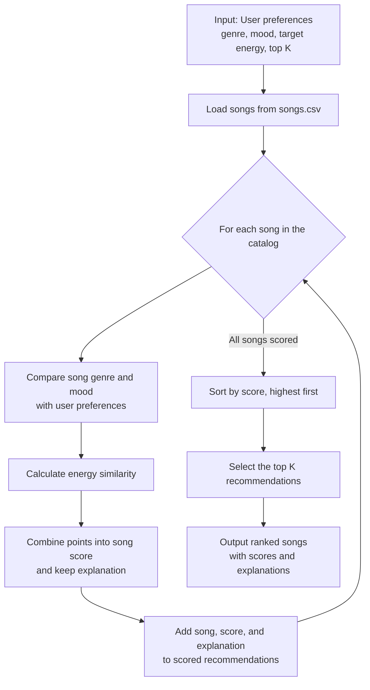

# 🎵 Music Recommender Simulation

## Project Summary

In this project you will build and explain a small music recommender system.

Your goal is to:

- Represent songs and a user "taste profile" as data
- Design a scoring rule that turns that data into recommendations
- Evaluate what your system gets right and wrong
- Reflect on how this mirrors real world AI recommenders

Replace this paragraph with your own summary of what your version does.

---

## How The System Works

Real-world recommenders combine signals from a listener's behavior, similar users, and item features, whereas our small simulation focuses on content-based matching. Each `Song` stores its ID, title, artist, genre, mood, energy, tempo (BPM), valence, danceability, and acousticness. The `UserProfile` stores a favorite genre and mood, a target energy, and whether the listener likes acoustic music.

#### Finalized Algorithm Recipe

1. Read the user's preferred genre, preferred mood, target energy, and requested number of recommendations (`k`), then load the song catalog from the CSV.
2. Visit every song and start its score at **0**. Add **2.0 points** if its genre matches the preferred genre and **1.0 point** if its mood matches. Genre and mood comparisons ignore capitalization and surrounding whitespace.
3. Add energy similarity points, calculated as `max(0, 1 - |song energy - target energy|)`, for up to **1.0 point**. Add the song, its total score, and a short explanation of the scoring reasons to the results.
4. Sort all results from highest to lowest score and return the first `k` (or none if `k` is less than zero).

The `likes_acoustic` preference is stored but is not used in this version of the score; tempo, valence, danceability, and acousticness are also not scoring features yet.

#### Potential Biases and Limitations

Genre receives twice the weight of mood, and its match can outweigh a strong mood or energy fit. This may over-prioritize genre and miss great songs that match the user's mood but come from another genre. The current recipe also ignores acoustic preference and several song attributes, and its results depend on which genres, moods, and energy levels are represented in this small catalog.

### Recommendation Data Flow



---

## Getting Started

### Setup

1. Create a virtual environment (optional but recommended):

   ```bash
   python -m venv .venv
   source .venv/bin/activate      # Mac or Linux
   .venv\Scripts\activate         # Windows

   ```

2. Install dependencies

```bash
pip install -r requirements.txt
```

3. Run the app:

```bash
python -m src.main
```

### Running Tests

Run the starter tests with:

```bash
pytest
```

You can add more tests in `tests/test_recommender.py`.

---

## Sample Recommendation Output

Paste a sample of your recommender's output here as a text block so a reader can see what it produces:

```
# e.g.:
# User profile: genre=indie, mood=chill, energy=low
# Recommendations:
#   1. ...
#   2. ...
#   3. ...
```

**Screenshot or video** _(optional)_: <!-- Insert a screenshot or demo video link here -->

---

## Experiments You Tried

Use this section to document the experiments you ran. For example:

- What happened when you changed the weight on genre from 2.0 to 0.5
- What happened when you added tempo or valence to the score
- How did your system behave for different types of users

---

## Limitations and Risks

Summarize some limitations of your recommender.

Examples:

- It only works on a tiny catalog
- It does not understand lyrics or language
- It might over favor one genre or mood

You will go deeper on this in your model card.

---

## Reflection

Read and complete `model_card.md`:

[**Model Card**](model_card.md)

Write 1 to 2 paragraphs here about what you learned:

- about how recommenders turn data into predictions
- about where bias or unfairness could show up in systems like this
